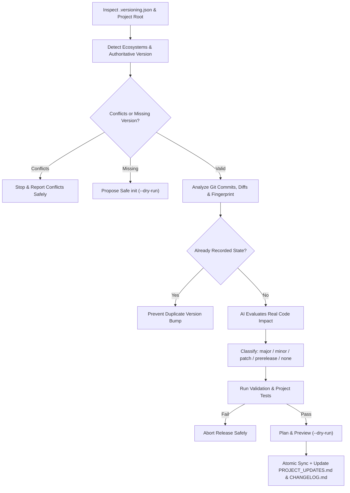

# Project Version Manager

An intelligent, portable **AI Agent Skill** and zero-dependency Python CLI for automatically detecting project versions, analyzing Git and workspace changes, managing **Semantic Versioning 2.0.0**, synchronizing version declarations across project files, maintaining `PROJECT_UPDATES.md`, and generating `CHANGELOG.md` entries and release notes.

---

## Why Use Project Version Manager?

AI coding agents frequently edit code without a reliable memory of what version a project is on, what changed in prior updates, or which manifest files must stay synchronized. Blindly bumping a version on every small edit creates noisy version inflation, while forgetting to update secondary files causes version drift.

**Project Version Manager** solves this by separating:
- **Semantic impact analysis** (performed by the AI agent inspecting real diffs and code behavior), and
- **Deterministic release mechanics** (performed by a tested Python standard-library CLI).

## Key Features

- **Automatic Ecosystem & Version Detection:** Identifies authoritative, dependent, and lockfile version sources across Node.js, Python, Rust, PHP/Composer, Java (Maven/Gradle), .NET, Dart/Flutter, Go, C/C++, Android/iOS, WordPress plugins/themes, and generic `VERSION` files.
- **Semantic Versioning 2.0.0 Engine:** Supports `MAJOR.MINOR.PATCH`, pre-releases (`alpha`, `beta`, `rc`), build metadata (`+build.105`), and configurable `0.x.y` pre-1.0.0 policies.
- **Git-Aware Change Inspection + Fingerprinting:** Reads SemVer tags, commits since the latest tag, staged/unstaged/untracked changes, falls back safely when Git is absent, and prevents duplicate version bumps using SHA-256 workspace fingerprints.
- **Safe Multi-File Synchronization:** Updates only targeted manifest fields (never dependency versions) with in-memory verification and atomic rollback on failure.
- **Dual Project Memory (`PROJECT_UPDATES.md` & `CHANGELOG.md`):** Keeps detailed chronological developer/AI history separate from public Keep-a-Changelog release notes.
- **Three Operational Modes:** `auto` (default), `suggest` (recommendations only), and `manual` (explicit user-requested bumps).
- **Zero External Dependencies:** Pure Python 3.10+ standard library CLI with `--json`, `--dry-run`, and `--help` support.

## Workflow Overview



## Semantic Versioning Rules

| Bump | When to Use | Example |
| --- | --- | --- |
| **MAJOR** | Breaking API/DB/architecture changes or feature removal (`1.x`+) | `1.4.2 -> 2.0.0` |
| **MINOR** | Backward-compatible new features, modules, endpoints, integrations | `1.4.2 -> 1.5.0` |
| **PATCH** | Backward-compatible bug fixes, security patches, error handling, small UI fixes | `1.4.2 -> 1.4.3` |
| **NONE** | Typos, comments, formatting, internal doc tweaks, unfinished work | `1.4.2 -> 1.4.2` |
| **Pre-1.0.0 (`0.x`)** | Configurable via `zero_major_policy` (`breaking_to_minor` default) | `0.4.2 -> 0.5.0` |

See [references/SEMVER_POLICY.md](./references/SEMVER_POLICY.md) for pre-release and graduation rules.

## Supported Project Types

- **Web / JavaScript / TypeScript:** HTML/CSS/JS, Node.js, React, Next.js, Vue, Angular, Express, Electron, React Native (`package.json`, `package-lock.json`)
- **Python:** Standard packages, Django, Flask, FastAPI (`pyproject.toml`, `setup.cfg`, `__init__.py` / `_version.py`)
- **Systems & Backend:** Rust (`Cargo.toml` `[package]` / `[workspace.package]`, `Cargo.lock`), PHP/Composer/Laravel (`composer.json`), Java/Spring Boot (`pom.xml`, `build.gradle`, `build.gradle.kts`), .NET/C# (`*.csproj` root & nested, `Directory.Build.props`), C/C++ (`CMakeLists.txt`), Go (`go.mod` + `VERSION` / Git tags)
- **Mobile:** Flutter/Dart (`pubspec.yaml`), Android (`app/build.gradle*`), React Native (`package.json`), Swift/iOS (`Info.plist`, `*.podspec`, `*.xcodeproj/project.pbxproj`, `Package.swift` + `VERSION`)
- **CMS:** WordPress plugins (`*.php` plugin header + `define('*_VERSION', ...)` + `readme.txt`), WordPress themes (`style.css`), WooCommerce extensions
- **Generic:** `VERSION`, `version.txt`, or custom `version_file`

## Installation

### As an Agent Skill (Antigravity / Compatible Agent Skills Hosts)

Clone or copy the `project-version-manager/` directory into your skills root:

- **Project-specific (workspace) skill:**
  ```bash
  git clone https://github.com/SMMpro-pk/Project-Version-Manager.git .agents/skills/project-version-manager
  ```
- **User-global skill (Antigravity global config):**
  ```bash
  git clone https://github.com/SMMpro-pk/Project-Version-Manager.git ~/.gemini/config/skills/project-version-manager
  ```

For other AI coding agents that support the open Agent Skills specification (`SKILL.md`), place `project-version-manager/` in that tool's configured skills directory.

### Requirements

- Python **3.10+** (standard library only; no `pip install` needed)
- Git (optional; filesystem fingerprinting fallback is used when Git is unavailable)

## Usage Examples

### Natural-Language Prompts for AI Agents

- *"Check my project version and tell me if all version files are synchronized."*
- *"Analyze what changed since the last release and recommend the next version."*
- *"Update the project version for the new authentication feature we just finished."*
- *"Generate release notes for version 1.5.0."*
- *"Initialize version tracking for this repository."*

### CLI Commands

All subcommands support `--json` for machine-readable output:

```bash
# Detect ecosystems, authoritative version, dependent files, and conflicts
python scripts/version_manager.py detect /path/to/project

# Show current & previous version, git state, and release readiness
python scripts/version_manager.py status /path/to/project

# Inspect commits since latest SemVer tag, working tree diffs, and workspace fingerprint
python scripts/version_manager.py analyze /path/to/project

# Validate SemVer strings, .versioning.json, and cross-file synchronization
python scripts/version_manager.py validate /path/to/project --strict

# Align out-of-sync dependent files to the authoritative version without bumping
python scripts/version_manager.py sync /path/to/project --dry-run
python scripts/version_manager.py sync /path/to/project

# Compare two versions across SemVer, history, changelog, and Git tags
python scripts/version_manager.py compare /path/to/project --from 1.4.0 --to 1.5.0

# Initialize version tracking safely for an unversioned project
python scripts/version_manager.py init /path/to/project --initial-version 0.1.0 --dry-run

# Create a structured release plan without modifying files
python scripts/version_manager.py plan /path/to/project \
  --bump minor \
  --category "New Feature" \
  --summary "Introduced automated project backup module." \
  --change "Added backup scheduler and configuration." \
  --area "Backend" \
  --added "Automated backup module and scheduler." \
  --testing "Passed." \
  --out release-plan.json

# Preview updates with --dry-run, then apply
python scripts/version_manager.py apply /path/to/project --plan release-plan.json --dry-run
python scripts/version_manager.py apply /path/to/project --plan release-plan.json

# Read chronological project update history and changelog sections
python scripts/version_manager.py history /path/to/project --limit 5

# Generate markdown release notes for the current or specified version
python scripts/version_manager.py release-notes /path/to/project --version 1.5.0
```

## Example `PROJECT_UPDATES.md`

```markdown
### Version 1.5.0 — 2026-11-10

**Update Type:** MINOR

**Category:** New Feature

**Summary:**
Introduced an intelligent project backup module.

**Changes:**
- Added automated backup functionality.
- Introduced backup scheduling.

**Affected Areas:**
- Backend
- Configuration

**Compatibility:** Backward compatible.

**Testing:** Passed.

**Migration Required:** No.
```

## Configuration (`.versioning.json`)

An optional `.versioning.json` file at the target project root customizes behavior. See [assets/versioning-config.example.json](./assets/versioning-config.example.json) and [references/CONFIGURATION.md](./references/CONFIGURATION.md) for all options (`mode`, `zero_major_policy`, `test_command`, `authoritative_file`, `ignore_paths`, etc.).

## Testing

Run the automated test suite and repository validations locally:

```bash
python -m unittest discover -s scripts -p "test_*.py" -v
python scripts/version_manager.py validate . --strict
```

## Limitations

- **Semantic impact requires an AI agent or human choice:** The Python CLI handles deterministic detection, validation, synchronization, and formatting; it does not attempt to guess semantic breaking/feature impact from arbitrary code diffs on its own.
- **Lockfile regeneration:** Root versions in `package-lock.json` and `Cargo.lock` can be updated when matched unambiguously, while `composer.lock` or complex workspace lockfiles should be refreshed with the ecosystem's native tool (`npm`, `cargo`, `composer`).
- **Dynamic version hooks:** Projects computing versions dynamically at build time (e.g., `setuptools-scm` or `attr:` in `setup.cfg`) may require explicit `authoritative_file` or `VERSION` configuration.
- **No GitHub Release / tag publishing by default:** Creating Git commits, tags, or remote GitHub releases is intentionally separated and never executed automatically without explicit user action.

## Contributing

Contributions are welcome! Please read [CONTRIBUTING.md](./CONTRIBUTING.md) and [SECURITY.md](./SECURITY.md) before submitting pull requests.

## License

Licensed under the [MIT License](./LICENSE).

